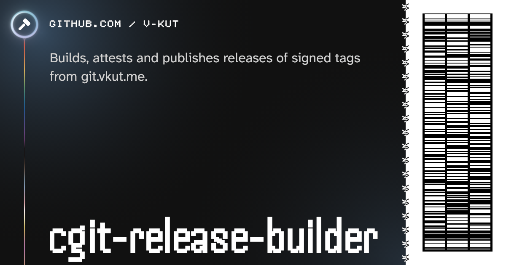

[](https://github.com/v-kut/cgit-release-builder)

# cgit-release-builder

Builds, attests and publishes releases of signed tags from git.vkut.me.

The repositories live on [git.vkut.me](https://git.vkut.me) (SHA-256, plain git + cgit); this repo
only runs their release builds on GitHub Actions and keeps the results as GitHub releases named
`<repo>-<tag>`.

## Usage

Enable releases for a repository on git.vkut.me, then push a signed `v*` tag:

```sh
ssh git@… release <repo> bun|uv|rust
```

Verify a download:

```sh
gh attestation verify ausculto-0.3.1.tgz --repo v-kut/cgit-release-builder
```

The attestation names the workflow and its inputs (repo, tag); `release.json` and the release
notes name the source commit on git.vkut.me, whose tag is signed by `code@vkut.me`.

## How a release happens

1. The server starts the repo's workflow with the repo and the pushed tag.
2. **build** (read-only token) clones the tag over HTTPS and checks that it is an annotated tag
   signed by a key in [`allowed_signers`](allowed_signers) and named as requested, that it isn't
   released yet, and that `CHANGES.md`/`CHANGELOG.md` (if present) has a `## [<version>]`
   section. Then it builds:

   | Workflow | Build |
   |---|---|
   | [`bun`](.github/workflows/bun.yml) | Bun from `packageManager`; `package.json` version must match the tag; `bun install --frozen-lockfile --ignore-scripts`; `typecheck` and `test` scripts if defined; then the `release` script if defined (writes to `$OUT`), else `build` (if defined) + `bun pm pack` |
   | [`uv`](.github/workflows/uv.yml) | project version must match the tag; `uv build` (sdist + wheel) |
   | [`rust`](.github/workflows/rust.yml) | per target (x86_64 and aarch64 Linux, native runners); toolchain from `rust-toolchain.toml`, else stable; `Cargo.toml` version must match the tag; `cargo test` + `cargo build --release --locked`; each binary as `<bin>-<version>-<target>.tar.gz` with README/licence files |

   An executable `.release` script in the repo replaces the build step of any workflow. It runs
   in the source checkout and gets `OUT` (directory for the files to publish: regular files only,
   tar directories), `TAG`, `VERSION` (tag without the `v`), `SOURCE_DATE_EPOCH` (commit time)
   and, for rust, `TARGET`.
3. **publish** ([`_publish.yml`](.github/workflows/_publish.yml), the only job with write
   access) attests the files with
   [artifact attestations](https://docs.github.com/en/actions/concepts/security/artifact-attestations)
   (Sigstore) and creates the release with them and `release.json` (source, commit, run,
   attestation, sha256 of every file), which git.vkut.me reads to show download buttons. The
   notes ([`release.py`](.github/scripts/release.py)) lead with the version's changelog section
   (else the tag message), then install commands, downloads and provenance.

Release builds start from a fresh runner with no caches.

## License

Everything is CC0-1.0.
Every file is labelled per [REUSE](https://reuse.software); the texts are in [LICENSES/](LICENSES).
